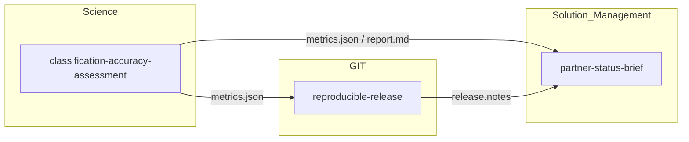

# EarthRISE Toolkit — Skill Library


The program-wide library of **Claude skills and workflows** for NASA EarthRISE.
Every team (**GIT** · **Science** · **Solution Management**) uploads the repeatable
jobs it does well as skills, so anyone in the program can run them from their own
Claude account, and the skills **chain together** to solve problems that cross all
three teams.

---

## Why
- **Same job, same standard.** An accuracy assessment, a release, a partner brief look the same no matter who runs them.
- **Cross-team by design.** Skills declare typed inputs/outputs, so a Science output plugs straight into a GIT or Solution Management skill.
- **Trust you can see.** Every skill carries a verification badge earned through review and evals, and badges expire if not maintained.

## Repository layout
```
earthrise-toolkit_skill_library/
├── GIT/                    # Software engineering skills
├── Science/                # Earth science skills
├── Solution_Management/    # Program / partner management skills
├── workflows/              # Cross-team chains of skills
├── standards/              # Skill standard, verification process, artifact vocabulary
├── templates/skill-template/   # Copy this to start a skill
├── scripts/                # validate, scaffold, package, build registry
├── registry/               # Generated catalog + skills.json (don't hand-edit)
└── .github/                # CI, CODEOWNERS, PR + issue templates
```

## The framework at a glance

### 1 · What a skill is
A folder Claude loads **only when a task matches it**: `SKILL.md` (instructions),
`skill.yaml` (library manifest), `README.md`, `evals/`, plus optional `scripts/`
and `references/`. One skill = **one repeatable job, done the EarthRISE way.**
→ [`standards/SKILL_STANDARD.md`](standards/SKILL_STANDARD.md)

### 2 · How skills connect — the I/O contract
Every skill declares `inputs` and `outputs` from one shared vocabulary
(`metrics.json`, `release.notes`, `aoi.geojson`, `stakeholder.brief`, …).
Matching types = chainable skills. The registry draws the connection map automatically.
→ [`standards/ARTIFACT_TYPES.md`](standards/ARTIFACT_TYPES.md) · [`registry/CATALOG.md`](registry/CATALOG.md)



### 3 · Verification & badges
| Badge | Bar |
|---|---|
|  | Passes the automated validator |
|  | In-team reviewer: rubric ≥ 70, evals ≥ 80% |
|  | + cross-team reviewer on a 2nd Claude account: rubric ≥ 85, evals ≥ 90%, 2 maintainers |
|  | + proven in a real cross-team workflow, Skill Council sign-off |
|  | Review date passed: counts as one level lower |
|  | Superseded or unsafe |

100-point rubric: trigger clarity · instruction quality · correctness & evals · guardrails & data handling · composability · documentation · maintainability.
→ [`standards/VERIFICATION.md`](standards/VERIFICATION.md)

### 4 · Cross-team collaboration
Teams work in **their own Claude accounts**. Collaboration happens through this repo:
1. Each team installs the skills it needs (packaged zip or `~/.claude/skills/`).
2. A workflow step finishes → its **artifact** is committed/shared in the agreed format.
3. A **hand-off issue** tags the next team with the artifact link and the skill to run.
4. Reviews cross teams too: `verified` requires a reviewer from another team.
→ [`workflows/`](workflows/)

## Design expectations (the short version)
1. **One job per skill.** If the description needs "and also", split it.
2. **Description = what + when.** It's the trigger; write the phrases people actually say.
3. **Typed I/O.** Use the shared artifact types; outputs must match the declared shape.
4. **Deterministic parts in scripts.** Math, conversion, validation → `scripts/` with `--help`.
5. **Guardrails are mandatory.** No fabricated numbers, no secrets, respect `data_sensitivity`, confirm before irreversible actions.
6. **Evals or it didn't happen.** ≥ 3 positive + 1 negative before any badge.
7. **Lean `SKILL.md`.** ≤ 500 lines; long material goes in `references/`.
8. **Owned and maintained.** An owner, a maintainer, a review date.

## Quick start

**Use a skill**

📽️ **New here?** Walk through the [contributor guide slides](docs/contributor-guide-slides.pdf).

```bash
python scripts/package_skill.py Science/classification-accuracy-assessment
# upload dist/classification-accuracy-assessment.zip in Claude's skills settings
# or, for Claude Code: copy the folder to ~/.claude/skills/
```

**Contribute a skill** → [`CONTRIBUTING.md`](CONTRIBUTING.md)
```bash
python scripts/new_skill.py Science my-skill --owner @you
python scripts/validate_skill.py Science/my-skill
python scripts/build_registry.py
```

## Seed skills
| Skill | Team | In → Out |
|---|---|---|
| [`classification-accuracy-assessment`](Science/classification-accuracy-assessment) | Science | `samples.csv`, `dataset.raster` → `metrics.json`, `report.md` |
| [`reproducible-release`](GIT/reproducible-release) | GIT | `code.repo`, `metrics.json` → `release.notes`, `env.lock` |
| [`partner-status-brief`](Solution_Management/partner-status-brief) | Solution Management | `metrics.json`, `release.notes` → `stakeholder.brief` |

Full list: [`registry/CATALOG.md`](registry/CATALOG.md).

## Governance
The **Skill Council** (one rep per team + Geo-AI Working Group lead) owns the
standard, the artifact vocabulary, `certified` sign-off and deprecations. Changes
to `standards/` need Council review (enforced by `CODEOWNERS`).
