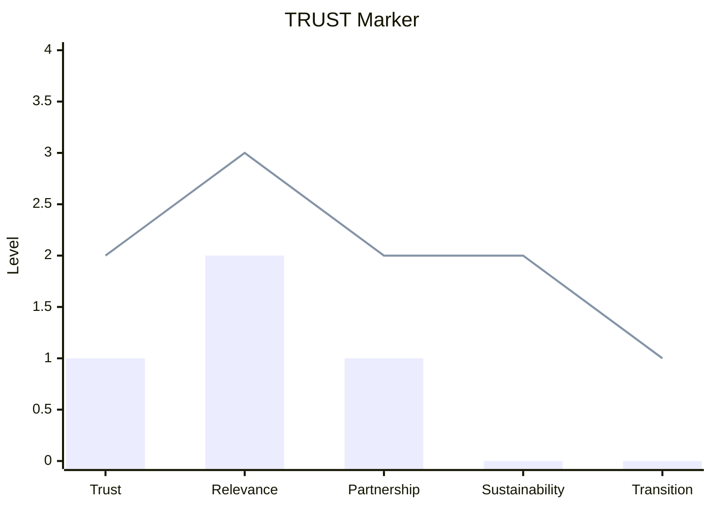

# TRUST Marker for Co-development (Agent Guide)

Read `references/conventions.md` first (shared rules: provenance tags, output format, commands, tool-number → skill-id map). State schema: `references/solution-profile.template.yaml`.

## Purpose
Planning and reflection framework assessing the **depth and integration of co-development practices**. Complements NASA ARLs (technical maturity) by focusing on relationships, operations, institutions. **Not** a readiness scale, fixed sequence, or compliance checklist. Higher is not always necessary — the aim is to find strengths, gaps, and opportunities. Dimensions may sit at different levels.

## Inputs
- `project.plan` — Solution profile or plan with engagement evidence.
- `report.md` — Optional engagement or activity reports used as evidence.
- Optional: `solution-profile.yaml` from any earlier toolkit skill (reused, never re-asked).

## Outputs
- `report.md` — Scored TRUST matrix with evidence, targets, gap actions, plus a YAML patch to `solution-profile.yaml` (schema in `references/solution-profile.template.yaml`).
- Exact table layouts: see **Output Spec** below.

## Matrix (exact cell text from Fillable TRUST Matrix)

| TRUST Dimension | 0 Internally Defined | 1 Stakeholder-Informed | 2 Collaborative | 3 Operationally Integrated | 4 Sustained & Transformative |
|---|---|---|---|---|---|
| **Trust-building** | Internal assumptions about stakeholder needs and priorities | Initial or intermittent stakeholder consultation and relationship-building | Ongoing regular engagement and iterative communication | Shared accountability and joint decision-making | Long-term trusted partnerships and sustained collaboration |
| **Relevance** | Generalized or internally defined problem framing without stakeholder input | Stakeholder needs and decision contexts identified | User workflows and operational realities incorporated into solution design | Solutions aligned with operational implementation needs and constraints | Solutions continuously adapted to evolving stakeholder needs |
| **User Partnership** | Users primarily informed about activities or outputs | Stakeholder feedback solicited periodically | Stakeholders actively participate in co-design and iterative development | Shared implementation, planning, and adaptation processes | Shared ownership, governance, or long-term stewardship of solutions |
| **Sustainability** | Long-term use and support not yet considered | Initial discussions of adoption, maintenance, or continuity | Transition planning and capacity-building activities initiated | Institutional integration and operational support structures established | Sustained operational support, continuity, and long-term institutional commitment |
| **Transition & Impact** | Anticipated benefits or intended applications identified | Intended operational use cases and pathways documented | Early evidence of adoption, usability, or stakeholder value | Operational use and implementation outcomes documented | Full transition and ongoing stewardship, with demonstrated long-term value |

## Steps
1. **Gather evidence** per dimension — from the profile first (e.g., `04` readiness, `05` validation, `07` tests, `11` handover, `12` indicator actuals), then ask 1 question per dimension: *"What has actually happened with stakeholders on X?"*
2. **Propose a level** per dimension with 1–2 lines of evidence. Rule: a level is met only if there is **evidence of that practice**, not intent. If evidence is plans only, score the lower level and note "planned".
3. **Ask for a realistic target** per dimension and timeframe (optional; may equal current).
4. **Gap → action**: for each dimension where target > current, recommend 1–3 concrete actions and the toolkit tool(s) that deliver them:
   - Trust-building → `04` (readiness, engagement strategy), `10` §15
   - Relevance → `05`, `06`, `07`
   - User Partnership → `07`, `04` (Collaborate tier), `11` §2.3
   - Sustainability → `11`, `09`
   - Transition & Impact → `12`, `02`, `03`
5. Suggest a re-assessment date (e.g., each phase gate).

## Output Spec

**Scored matrix** (check one box per row = current; ◎ = target)

| TRUST Dimension | Current Level | Target Level | Evidence | Gap Actions | Tool(s) |
|---|---|---|---|---|---|
| Trust-building | | | | | |
| Relevance | | | | | |
| User Partnership | | | | | |
| Sustainability | | | | | |
| Transition & Impact | | | | | |

**Fillable matrix rendering** — reproduce the 5×5 matrix above with `☑` in the current cell and `◎` in the target cell for docx paste-back.

Optional chart (current vs target):

**Profile patch:** `trust.*`.

## Quality Gate
- [ ] All five dimensions scored with evidence (not intent).
- [ ] Targets are realistic, not reflexively 4.
- [ ] Every gap has ≥1 action and a tool.
- [ ] Re-assessment date set.

## Guardrails
- Never score a level on intent or plans; require evidence of the practice.
- Never push every target to level 4 by default.
- Never invent people, organizations, quotes, budgets, or baselines; use `<<placeholders>>` and tag AI-drafted rows `[AI-DRAFT]`.
- AI drafts prepare for stakeholder engagement; never present them as stakeholder evidence.
- Never store or echo PII, CUI, or ITAR/EAR-controlled data; replace with placeholders and warn the user.
- Never send, post, or share outputs; produce them for the user to review.

## Example
**Prompt:** Score our TRUST Marker. We've held two stakeholder interviews and nothing else.
**Result:** Trust-building scored 1 with interview evidence; Every gap has an action and a named sco- skill.

## Hand-offs
- Upstream: none (entry point)
- Downstream: `sco-toolkit-orchestrator`

## Source
- Toolkit page: https://science.data.nasa.gov/earth-science-solution-co-development-toolkit/trust-marker/
- Phase: Any (baseline at start; re-score each phase)
- Template — Fillable_TRUST_Matrix.docx: https://science.data.nasa.gov/earth-science-solution-co-development-toolkit/static/toolkit_documents/Fillable_TRUST_Matrix.docx
- Derived from NASA Earth Action Solution Co-Development Toolkit v0.1 (DOI 10.5281/zenodo.19866469).

## References
- `references/conventions.md` — read first, every run.
- `references/solution-profile.template.yaml` — when creating or patching the shared profile.
