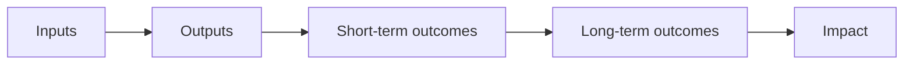

# Tool 1 — Designing for Impact (Agent Guide)

Read `references/conventions.md` first (shared rules: provenance tags, output format, commands, tool-number → skill-id map). State schema: `references/solution-profile.template.yaml`.

## Purpose
Articulate the real-world change the project aims to support and link science outputs to outcomes and impact. Impact is treated as a **testable hypothesis**.


## Inputs
- `partner.request` — Partner need and the decision the solution supports.
- Optional: `solution-profile.yaml` from any earlier toolkit skill (reused, never re-asked).

## Outputs
- `project.plan` — Results narrative, results framework table, assumption record with CSV, plus a YAML patch to `solution-profile.yaml` (schema in `references/solution-profile.template.yaml`).
- Exact table layouts: see **Output Spec** below.


## Key definitions (use these exact meanings)
- **Inputs** — resources and activities invested (data processing, research, modeling, training, co-design sessions).
- **Outputs** — science products and materials (models, data products, dashboards, advisories, workflows, reports). NASA-friendly: "science products".
- **Outcomes** — changes in user behavior or decisions. Short-term = initial adoption; longer-term = sustained use. NASA-friendly: "influence decisions and actions".
- **Impact** — broader societal or environmental change beyond deliverables; often only visible medium-to-long term.
- **Results framework** (logic chain / if-then pathway) — transparent chain inputs → outputs → outcomes → impact.

## Five principles (enforce while facilitating)
1. Start with a need articulated by a user or decision-maker.
2. Envision impact before defining activities.
3. Co-develop with stakeholders.
4. Make assumptions explicit.
5. Iterate and adapt.

## Steps

**Step 1 — Define the Challenge.** Ask: What is the need? Why does it matter (who is harmed, what is lost)? Then draft a one-sentence problem statement.
- If Needs Assessment (`05`) exists, pull from `needs` and confirm. Otherwise flag `[ASSUMPTION]` and recommend validating with stakeholders.
- Example — Need: lack of accurate crop yield estimates for remote areas. Why: governments cannot plan for shortages; farmers cannot secure insurance. Problem statement: *Insufficient crop-yield information increases food-security risks and financial losses.*

**Step 2 — Identify Stakeholders.** Pull `stakeholders` from profile, or ask for users, implementers, decision-makers. If none, offer to run `04` now or list `[AI-DRAFT]` candidate categories only (no invented names).

**Step 3 — Articulate the If/Then Logic.** Draft 1–3 statements in the form:
> If we ____, then users will ____, then ____ will improve.

Examples:
- If we train municipal staff on drought dashboards, then users integrate drought alerts into water-allocation planning, then seasonal shortages may be reduced.
- If we co-design a fuel moisture and weather bulletin, then users share advice with foresters, then runaway prescribed fires may decrease, then lives and livelihoods are protected.

**Step 4 — Build the Results Framework.** Translate if/then into the four tiers. Push back if an "outcome" is really an output (a product) or if an "impact" is really an outcome (a behavior change).

**Step 5 — Identify Assumptions and Risks.** For **each link** (Inputs→Outputs, Outputs→Outcomes, Outcomes→Impact), propose assumptions. Common: users have technical capacity; data-sharing agreements stay in place; institutional mandates allow uptake; internet connectivity is sufficient; data/information latency is sufficient.

**Step 6 — Monitor, Adapt, Assess.** For each outcome and impact, suggest one candidate indicator and hand off to `12 Meaningful Metrics` / `10 SIIMP §12.1`.

## Output Spec

**A. Results Narrative** (mirrors Fillable Results Narrative)
```
Need:
Why it matters:
Problem statement:
Stakeholders (users / implementers / decision-makers):
If/Then pathway:
Narrative (150–300 words): <inputs> produce <outputs>, which enable <users> to <outcomes>, contributing to <impact>. Key assumptions: ...
```

**B. Results Framework table** (mirrors Fillable Results Framework slide)

| Tier | Statement | Indicator (candidate) | Source |
|---|---|---|---|
| Impact | | | |
| Outcome — long-term | | | |
| Outcome — short-term | | | |
| Output | | | |
| Input | | | |

**C. Assumption Record** (Step 5 fields, exact)

| ID | Link | Assumption | Why it matters | How to monitor | Action if it fails | Source |
|---|---|---|---|---|---|---|

Plus CSV for B and C, and a Mermaid diagram:


**Profile patch keys:** `impact.*`, `assumptions[]`.

## Quality Gate
- [ ] Need is stated from a user/decision-maker perspective, not a science gap.
- [ ] Every outcome is a change in behavior/decision by a named user type.
- [ ] Impact is beyond project deliverables and plausibly attributable.
- [ ] Each tier link has ≥1 assumption with monitor + action-if-fails.
- [ ] Outputs map to NASA assets (missions/products) where relevant.
- [ ] `[AI-DRAFT]` items listed for stakeholder validation.

## Worked example (toolkit)
- **Hail insurance:** GOES-16, GPM, MERRA-2 detect hailstorms and damage → faster insurer verification and farmer payouts → timely replanting.
- **NASA program:** Soil-moisture estimates (output) → more efficient, accurate drought assessments (outcome) → better anticipation, resource allocation, insurance claims, disaster relief (impact).

Reference: Application Readiness Level metric — https://carbon.nasa.gov/docs/The%20ARL%20Metric.pdf

## Guardrails
- Never relabel an output (product) as an outcome or an outcome as impact.
- Never invent baselines or stakeholder names.
- Never invent people, organizations, quotes, budgets, or baselines; use `<<placeholders>>` and tag AI-drafted rows `[AI-DRAFT]`.
- AI drafts prepare for stakeholder engagement; never present them as stakeholder evidence.
- Never store or echo PII, CUI, or ITAR/EAR-controlled data; replace with placeholders and warn the user.
- Never send, post, or share outputs; produce them for the user to review.

## Example
**Prompt:** Build a results framework for our NASA soil-moisture drought tool for state ag extension.
**Result:** Produces Impact / Outcome long / Outcome short / Output / Input table; Every outcome is a behavior or decision change by a user type; Assumption record has monitor and action-if-fails per link.

## Hand-offs
- Upstream: `sco-05-needs-assessment`, `sco-04-stakeholder-mapping`
- Downstream: `sco-10-implementation-monitoring-plan`, `sco-12-meaningful-metrics`, `sco-06-information-chain-analysis`, `sco-07-user-centered-design`

## Source
- Toolkit page: https://science.data.nasa.gov/earth-science-solution-co-development-toolkit/designing-for-impact/
- Phase: Foundational (primary Phase 1; revisit throughout)
- Template — Fillable Results Narrative (Google Doc): https://docs.google.com/document/d/10CsxBj6OPVhqANu8ltliY5KabnHfHCTDNJAqW4ZA1no
- Template — Sample Results Narrative (Google Doc): https://docs.google.com/document/d/1zel3fDal1obW_l7Sf5bz_n2qdL7f8znVuDXFMrWTzsg
- Template — Fillable / Sample Results Framework (Google Slides): https://docs.google.com/presentation/d/1LY2tE5McwaIL48I5LAu-AV9ANFbLD0qh
- Derived from NASA Earth Action Solution Co-Development Toolkit v0.1 (DOI 10.5281/zenodo.19866469).

## References
- `references/conventions.md` — read first, every run.
- `references/solution-profile.template.yaml` — when creating or patching the shared profile.
