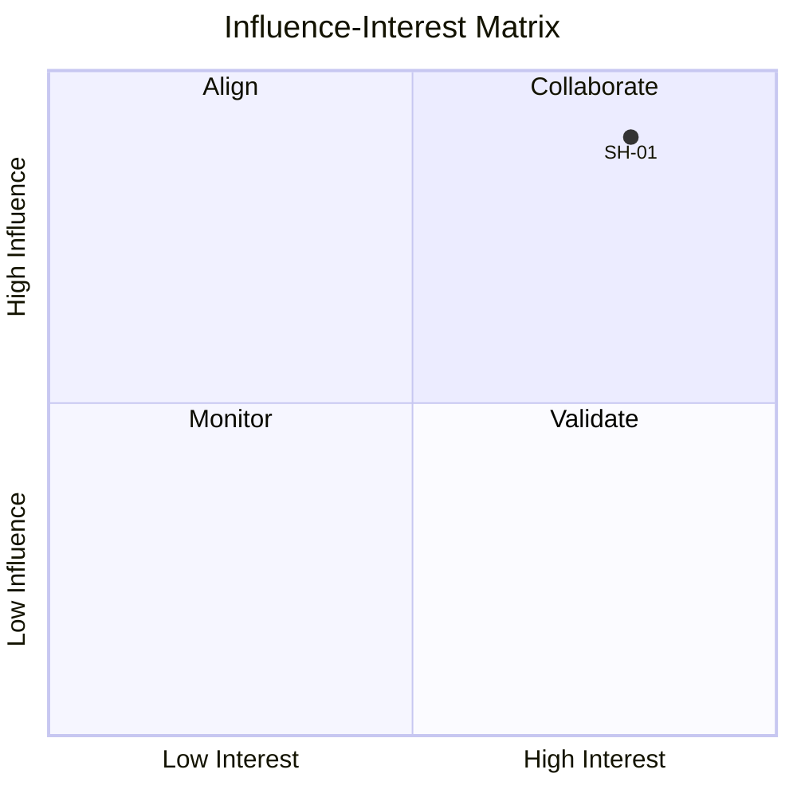

# Tool 4 — Stakeholder Mapping & Analysis (Agent Guide)

Read `references/conventions.md` first (shared rules: provenance tags, output format, commands, tool-number → skill-id map). State schema: `references/solution-profile.template.yaml`.

## Purpose
Rapidly identify, prioritize, and engage the people and institutions who shape solution success. Not exhaustive; supports co-development, outreach, planning.

**Outputs:** Stakeholder Map · Stakeholder Analysis Snapshot (interest, influence, relationship readiness) · near-term engagement priorities for Phase 1.

## Inputs
- `partner.request` — Preliminary need and solution scope.
- Optional: `solution-profile.yaml` from any earlier toolkit skill (reused, never re-asked).

## Outputs
- `report.md` — Stakeholder mapping table, influence-interest matrix, workflow dashboard, key insights with CSV, plus a YAML patch to `solution-profile.yaml` (schema in `references/solution-profile.template.yaml`).
- Exact table layouts: see **Output Spec** below.

## Before you start
- Confirm a preliminary real-world need and NASA Earth science opportunity exist (from `01` or ask for 1–2 sentences).
- Suggest a 3–5 person mapping team: lead; EO technical specialist(s); social science/engagement specialist(s); economist/impact analyst as needed. Ask who fills each role (role titles only are fine).
- Keep scope narrow: a single service or problem area.

## Category reference (Step 1)

| Category | Definition / Role | Key Characteristics / Responsibilities | Examples |
|---|---|---|---|
| Users | Interact directly with EO products, data, or services to make decisions or perform tasks | Early demand signals | National met offices using models; river basin authorities using dashboards; ag extension officers using crop monitoring |
| Beneficiaries | Positively affected by EO-derived decisions, often without using the data | Describe real-world issue; source impact quotes | Farmers using planting advisories; communities receiving flood warnings; fisherfolk using water-quality alerts |
| Enablers — Data Providers / Enablers | Host, manage, maintain data pipelines | Support or block adoption | NASA DAACs, NOAA offices, research labs |
| Enablers — Implementing Partners | Translate/deliver products to end users | | NGOs, UN agencies, ministries |
| Enablers — Funders / Financial Partners | Fund or enable scale | | Donor agencies, foundations |
| Enablers — Decision-Makers / Policy Actors | Shape adoption, regulation, institutional support | | Emergency managers, policy units, Tribal nations, regulators |
| Enablers — Local Actors / Community Orgs | Influential for users and beneficiaries | | Local authorities, CBOs |
| Enablers — Prior Collaborators / Internal NASA Connections | Existing trust relationships | | Mission Application Leads, Earth Action teams, previous PIs |

## Steps

**Step 1 — Identify Key Groups.** Prioritize breadth. Ask the user to brain-dump names/organizations; you sort into categories and assign Primary and Secondary roles. Flag stakeholders with multiple strong roles (e.g., User + Beneficiary) as candidates for co-design and user testing. You may suggest *missing categories* (e.g., "no Data Provider listed") but not invent organizations.

**Step 2 — Relationship Readiness.** For each stakeholder, independent of interest/benefit:
- Established (ongoing, trusted, regular) · Nascent (limited/informal, developing) · To Be Initiated (none)
- Best-positioned team member to engage · existing NASA relationships (prompt user to check EAX) · known constraints/enablers.

**Step 3 — Influence & Interest (1–4).**
- *Influence*: ability to enable, block, shape, or scale (decision authority; control of resources, data, implementation pathways; ability to legitimize outcomes).
- *Interest*: degree the stakeholder's mandate/outcomes are affected — **structural relevance, not enthusiasm or relationship strength**.
- Propose scores with one-line rationale each; user confirms. High = 3–4, Low = 1–2.

**Step 4 — Engagement Strategy** (auto-assign, user can override):

| Engagement Type | Influence / Interest | Engagement Approach |
|---|---|---|
| Collaborate | High / High | Deep, two-way; stakeholders actively shape the solution |
| Align | High / Low | Keep informed and coordinated; keep activities and policies consistent |
| Validate | Low / High | Periodic check-ins to confirm assumptions, gather feedback, test designs |
| Monitor | Low / Low | Light-touch tracking for shifts |

**Step 5 — Summarize Key Insights.** 3–5 takeaways: main users, beneficiaries, enablers (critical allies, potential champions); major engagement gaps; who can be engaged immediately.

## Output Spec

**Stakeholder Mapping Table** (one row per stakeholder; maps to worksheet Steps 1–4)

| ID | Stakeholder | Primary Category | Secondary Category | Definition / Role | Key Characteristics / Responsibilities | Relationship Readiness | Best-Positioned Team Member | Existing NASA Relationship (EAX) | Constraints / Enablers | Influence (1–4) | Interest (1–4) | Engagement Strategy | Source |
|---|---|---|---|---|---|---|---|---|---|---|---|---|---|

**Influence-Interest Matrix** (mirrors the worksheet tab)

| | Low Interest (1–2) | High Interest (3–4) |
|---|---|---|
| **HIGH INFLUENCE (3–4)** | ALIGN — Stakeholders: | COLLABORATE — Stakeholders: |
| **LOW INFLUENCE (1–2)** | MONITOR — Stakeholders: | VALIDATE — Stakeholders: |

Mermaid (renders on GitHub):

(Plot = ((interest−1)/3, (influence−1)/3).)

**Workflow Dashboard**

| Activity | Led By | Output | Notes | Status |
|---|---|---|---|---|
| Define scope & criteria | EO Program Manager + Social Science / Local Engagement Lead | Purpose statement + prioritization matrix | Keep scope narrow | |
| Draft stakeholder list | EO Technical Lead + Team | Initial mapping table | Use EAX / partner lists | |
| Validate & expand | Social Science Lead + Economist + Team | Updated list w/ influence, impact, engagement potential | Include policy & economic dimensions | |
| Visualize & brief | EO Team | Map + summary | | |
| Leadership review | EO Program Manager | Prioritized map + engagement plan | Feeds planning/proposals | |

**Key Insights** — 3–5 bullets.

**Profile patch:** `stakeholders[]`, `stakeholder_insights[]`.

## Quality Gate
- [ ] All three top-level categories considered (Users, Beneficiaries, Enablers); gaps named.
- [ ] Every row has readiness, influence, interest, strategy.
- [ ] Interest scored on structural relevance, not enthusiasm.
- [ ] ≥1 Collaborate stakeholder who is a User (co-design candidate).
- [ ] Immediate-engagement list and engagement gaps stated.
- [ ] No invented organizations or people.

## Hand-off
→ `05 Needs Assessment`: priority user groups = Users/Collaborate+Validate rows. → `10 SIIMP §3` and `11 §1` reuse this table.

> Note: worksheet column names for Steps 2–4 are reconstructed from the published step guidance (the Google Sheet tabs were not machine-readable). Paste a CSV export of the sheet to align headers exactly.

## Guardrails
- Never invent organizations or people; suggest missing categories only.
- Score interest on structural relevance, not enthusiasm.
- Never invent people, organizations, quotes, budgets, or baselines; use `<<placeholders>>` and tag AI-drafted rows `[AI-DRAFT]`.
- AI drafts prepare for stakeholder engagement; never present them as stakeholder evidence.
- Never store or echo PII, CUI, or ITAR/EAR-controlled data; replace with placeholders and warn the user.
- Never send, post, or share outputs; produce them for the user to review.

## Example
**Prompt:** Map stakeholders for a flood early warning service: national met office, district DRM, local NGOs, World Bank.
**Result:** Every row has category, readiness, influence, interest, strategy; Includes influence-interest matrix with Collaborate/Align/Validate/Monitor.

## Hand-offs
- Upstream: `sco-01-designing-for-impact`
- Downstream: `sco-05-needs-assessment`, `sco-06-information-chain-analysis`, `sco-10-implementation-monitoring-plan`, `sco-11-adoption-sustainability`

## Source
- Toolkit page: https://science.data.nasa.gov/earth-science-solution-co-development-toolkit/stakeholder-mapping/
- Phase: 1 (secondary in Phase 2)
- Template — Stakeholder_Mapping_Worksheet.xlsx (Google Sheets): https://docs.google.com/spreadsheets/d/1EHsl2vM4wPCih9ZgxlXPkCuII6rch_H1/edit?gid=259758918
- Derived from NASA Earth Action Solution Co-Development Toolkit v0.1 (DOI 10.5281/zenodo.19866469).

## References
- `references/conventions.md` — read first, every run.
- `references/solution-profile.template.yaml` — when creating or patching the shared profile.
