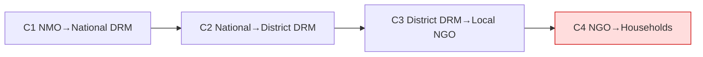

# Tool 6 — Information Chain Analysis (ICA) (Agent Guide)

Read `references/conventions.md` first (shared rules: provenance tags, output format, commands, tool-number → skill-id map). State schema: `references/solution-profile.template.yaml`.

## Purpose
Make information-flow breakdowns visible, specific, and fixable. Outputs: (a) prioritized list of information-flow risks, (b) design actions for co-design, delivery, monitoring.

## Inputs
- `partner.request` — Priority decisions from needs assessment.
- `report.md` — Stakeholder map (actors).
- Optional: `solution-profile.yaml` from any earlier toolkit skill (reused, never re-asked).

## Outputs
- `report.md` — ICA Step 1–6 tables and chain diagram with CSV, plus a YAML patch to `solution-profile.yaml` (schema in `references/solution-profile.template.yaml`).
- Exact table layouts: see **Output Spec** below.

## Core rules
- **One decision per ICA.** If the user names >1 decision or endpoint, split into ICA-1, ICA-2… (they can be layered later to reveal system bottlenecks).
- **Chain link** = a point where information changes form, moves between actors, or crosses an institutional/technical boundary.
- Per link ask: Where does info originate? Who interprets it, how? How/when delivered? Who acts, under what constraints?
- Typical chain: EO product generation → analyst interpretation → advisory/alert → channel transmission → decision-maker uptake.
- Every issue ties to **one** link; every action ties to **one** link and **one** prioritized issue.

## Steps (tabs: Step 1 — Anchor … Step 6 — Assumptions)

**Step 1 — Anchor.** Fill the six fields. Pull candidate decisions from `needs[].decision_affected`.

**Step 2 — Map.** Build C1, C2, … from source to end user. For each: From → To actor, information received, decision/interpretation applied, channel. Stop when info reaches the intended user **with a clear, actionable instruction**. Suggest actor/channel types from the reference lists below.

**Step 3 — Stress-Test.** Per link: what must go right; what actually happens; breakdown type = **delay · capacity · access · trust · distortion**. Use channel assessment questions (below) as probes.

**Step 4 — Prioritize.** Score each issue for impact on decision quality/timing, outcomes, equity/access (H/M/L). Output a short list (usually 2–5) of high-impact issues.

**Step 5 — Actions.** For each priority issue: intervention type (**design · delivery · engagement**), concrete action, responsible actor, implementation phase (**co-design · pilot · deployment**).

**Step 6 — Assumptions & Risks.** Extract (don't brainstorm new) assumptions embedded in Steps 2–5. For each: risk if false, how monitored/tested. These feed Results Framework indicators and MEL questions.

## Reference lists
**Actors:** technical & communications staff; national/regional/local government; disaster mgmt agencies & EOCs; NGOs, CSOs, implementing partners; extension services & field officers; community leaders; end users & affected communities; donors & coordinating bodies. (An actor may appear multiple times in different roles.)

**Channels:** Broadcast & print (radio, TV, newspapers, PSAs) · Digital & mobile (websites, dashboards, email, portals, apps, SMS, messaging) · Institutional (briefings, sitreps, memos, coordination meetings, command centers) · Community-based (boards, town meetings, markets, roadside signs, trusted intermediaries) · Feedback (hotlines, reporting apps, community meetings, forums).

**Channel assessment questions:** Which stakeholders use which channels, at what stage? Where do delays/distortions occur? One-way or two-way? Do accessibility, literacy, language, connectivity limit use? Do users trust the information? Do informal channels complement or substitute formal ones?

## Output Spec

**Step 1 — Anchor** (exact row labels from worksheet)

| Field | Entry |
|---|---|
| Priority decision | |
| Decision-maker(s) | |
| Decision timing | |
| Intended beneficiary / end user | |
| Information product(s) | |
| Consequence of failure if information fails | |

**Step 2 — Map**

| Link | From (Actor) | To (Actor) | Information Received | Decision / Interpretation Applied | Channel |
|---|---|---|---|---|---|

**Step 3 — Stress-Test**

| Link | What Must Go Right | What Actually Happens | Breakdown Type | Evidence / Source |
|---|---|---|---|---|

**Step 4 — Prioritize**

| Issue ID | Link | Issue | Decision Quality/Timing | Outcomes | Equity/Access | Priority |
|---|---|---|---|---|---|---|

**Step 5 — Actions**

| Link | Priority Issue | Intervention Type | Action | Responsible Actor | Implementation Phase |
|---|---|---|---|---|---|

**Step 6 — Assumptions**

| ID | Link | Assumption | Risk if False | How Monitored / Tested |
|---|---|---|---|---|

Chain diagram:

**Profile patch:** `decision_pathways[]`; append Step 6 rows to `assumptions[]` with `source_tool: 06`.

## Quality Gate
- [ ] Exactly one decision; endpoint = actionable instruction to intended user.
- [ ] Every link has from/to, input, interpretation, channel.
- [ ] Every issue has a breakdown type and is tied to one link.
- [ ] Equity/access considered for every priority issue.
- [ ] Every action → one link + one issue + owner + phase.
- [ ] Assumptions extracted (not invented) with monitoring method.

## Worked example (toolkit)
- **Anchor (Chain 1):** Activate district flood preparedness measures · District Disaster Management Committee · 24–72 h before peak · Flood forecast and alert bulletin · Delayed evacuation increases risk to life. (Chain 2: inform resilience planning · State Climate Resilience Office · post-event · flood extent maps + socio-economic layer · repeated flood events.)
- **Links:** C1 National Met Org → National DRM (forecast → national alert level) · C2 National DRM → District DRM (alert → evacuation thresholds met?) · C3 District DRM → Local NGO (decision → local instructions/channels) · C4 Local NGO → Households (instruction → evacuate/prepare).
- **Stress-test:** C2 alerts translated slowly on weekends (delay) · C4 WhatsApp excludes elderly residents (access).
- **Priority:** C4 access barrier for elderly (high; prevents evacuation).
- **Actions:** C2 delay → Delivery → automate SMS alerts to district leads (National DRM) · C4 access → Delivery → radio announcements for elderly households · C4 trust → Engagement → train community leaders on key messages.
- **Assumptions:** C3 district staff act on alerts immediately → no evacuation if false → post-event staff meetings · C4 NGOs disseminate promptly → late info if false → periodic randomized checks.

> Note: Step 1 row labels are exact; Steps 2–6 column headers are reconstructed from the published step definitions.

## Guardrails
- Analyze one decision per ICA; split multiple decisions.
- Extract assumptions from Steps 2–5; do not brainstorm new ones.
- Never invent people, organizations, quotes, budgets, or baselines; use `<<placeholders>>` and tag AI-drafted rows `[AI-DRAFT]`.
- AI drafts prepare for stakeholder engagement; never present them as stakeholder evidence.
- Never store or echo PII, CUI, or ITAR/EAR-controlled data; replace with placeholders and warn the user.
- Never send, post, or share outputs; produce them for the user to review.

## Example
**Prompt:** Map the information chain from flood forecast to household evacuation.
**Result:** Step 1 Anchor table with the six exact fields; Links C1..Cn with breakdown types from delay/capacity/access/trust/distortion.

## Hand-offs
- Upstream: `sco-04-stakeholder-mapping`, `sco-05-needs-assessment`
- Downstream: `sco-07-user-centered-design`, `sco-08-technical-requirements`, `sco-12-meaningful-metrics`, `sco-11-adoption-sustainability`

## Source
- Toolkit page: https://science.data.nasa.gov/earth-science-solution-co-development-toolkit/information-chain-analysis/
- Phase: 1 (secondary in Phases 2–3)
- Template — ICA_Worksheet_All Steps.xlsx (Google Sheets): https://docs.google.com/spreadsheets/d/1YaT-YCXNPUeqECTnpKF9_Xj-IQ5JmbAP/edit?gid=1640323216
- Template — Step-by-step guidance (Google Doc): https://docs.google.com/document/d/1tgW-T5S_0-QgC6C_Hs40V5S3gSQMRTROOnlhOuRdY0I
- Derived from NASA Earth Action Solution Co-Development Toolkit v0.1 (DOI 10.5281/zenodo.19866469).

## References
- `references/conventions.md` — read first, every run.
- `references/solution-profile.template.yaml` — when creating or patching the shared profile.
