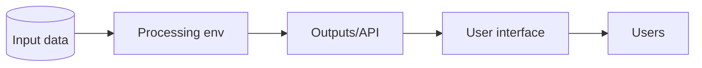

# Tool 8 — Technical Requirements Template (Agent Guide)

Read `references/conventions.md` first (shared rules: provenance tags, output format, commands, tool-number → skill-id map). State schema: `references/solution-profile.template.yaml`.

## Purpose
Specify data, software, processing platforms, outputs, and hardware that guide solution production. Document technical needs surfaced in Phase 1 and other Phase 2 tools.

## Inputs
- `partner.request` — EO requirements from needs assessment.
- `report.md` — UCD and ICA outputs.
- Optional: `solution-profile.yaml` from any earlier toolkit skill (reused, never re-asked).

## Outputs
- `report.md` — Both template tables, data source table, code dependencies, checklist, architecture diagram, plus a YAML patch to `solution-profile.yaml` (schema in `references/solution-profile.template.yaml`).
- Exact table layouts: see **Output Spec** below.

## Steps

### Part A — Key Questions for Co-Development Partners
Walk through each row; ask only what's not in the profile.

1. **Agreements** — Need collaboration agreements? (link, or note one exists). Types: email confirmation · signed meeting minutes confirming roles · letter of collaboration · interagency agreement · DAACS agreement · legal collaboration agreement · external partners collaboration agreement. Data-sharing agreements / NDAs? Open vs. private data? Encryption needed (if yes, add encryption tool to software list)? Roles & responsibilities link.
2. **Data sharing mechanisms** → defer to `09 Data Governance`.
3. **Communication with partners** — channels for co-development? Everyday exchange/meeting tools?
4. **Existing partner capabilities** → pull from `04` stakeholders.
5. **User feedback** → `07 UCD`. How collected before production; timing across lifecycle; how integrated into design.
6. **Inputs** — for Development & Testing · Deployment · System Maintenance.
7. **Outputs** — desired outputs · MVP · addresses user needs (stakeholder sign-off)? · integrates feedback? · future-use considerations.
8. **Deliverables** → `10 SIIMP` / `01`.
9. **End user requirements** → `11` / `07`.

### Part B — Technical Requirements / Example Specifications
For each data source, prefill from `eo_requirements[]` and suggest candidate NASA/partner products that meet spatial/temporal/latency needs — label suggestions `[AI-DRAFT]` and ask the user to confirm (product specs must be verified against Earthdata/DAAC docs).

Validate: does any requirement from `05 Step5` lack a data source that meets it? Flag as a **gap**.

## Output Spec

**Table 1 — Key Questions for Co-Development Partners** (exact row labels)

| Item | Response |
|---|---|
| Agreements | |
| What are the data sharing mechanisms between partners? | Refer to Data Governance and Storage Plan |
| Communication with partners | |
| Existing partner capabilities | |
| User feedback | |
| Inputs (Development & Testing / Deployment / System Maintenance) | |
| Outputs (desired / MVP / meets needs / feedback integrated / future use) | |
| Deliverables | |
| End user requirements | |

**Table 2 — Technical Requirements / Example Specifications** (exact row labels)

| Technical Requirements | Specification |
|---|---|
| Existing data and tools | see Data Source table |
| Existing methods and approaches | |
| Existing codes | |
| Relevant tools prior to design | Stakeholder Mapping · Needs Assessment · UCD (links) |
| User-centered design | |
| System architecture and workflow | Mermaid diagram |
| Codes to be leveraged and their dependencies | |
| Information security and responsible AI use | |
| Input data | |
| Field data / in situ data requirements | Required for validation of outputs |
| Output data and data formats | |
| Metadata | Refer to Data Governance and Storage Plan |
| Processing environment (platform) | |
| File naming convention | Refer to Data Governance and Storage Plan |
| Versioning strategy | Refer to Data Governance and Storage Plan |
| Storage location & backups | Refer to Data Governance and Storage Plan |
| User co-design | |
| Validating results and system testing | checklist below |
| Deployment environment (platform) | |
| Key considerations | |
| Sharing permissions | Refer to Data Governance and Storage Plan |
| Branding and acknowledgment requirements | Refer to Data Governance and Storage Plan |
| System maintenance and transfer | Refer to Solution Adoption and Sustainability Plan |
| Existing technical capacities | servers, compute, data, staffing |
| Additional required technical capacities | |

**Data Source table** (per "Data source 1…n")

| Data Source | Cloud-based (e.g., COG) or Downloadable | Access (Open / Purchase required) | Spatial Resolution (m, cm) | Spectral Resolution (# bands) | Latency (days, hours) | Level of Analysis Readiness (Processing Level) | Meets Req ID | Source |
|---|---|---|---|---|---|---|---|---|

**Code dependencies**

| Code | Repo / Link | Dependencies | License |
|---|---|---|---|

**Validation & deployment checklist**
- [ ] Results meet validation thresholds?
- [ ] Prototype/system tested and retested before deployment?
- [ ] System and results meet intended needs?
- [ ] UI/UX meets user requirements (per `07`)?
- [ ] Deployment successful?
- [ ] MVP met?

Architecture:

**Profile patch:** `technical.*`.

## Quality Gate
- [ ] Agreement status known for every Collaborate partner.
- [ ] Every Do-now EO requirement has ≥1 data source meeting it (or a logged gap).
- [ ] MVP defined in one sentence and tied to a persona/need.
- [ ] In situ validation data identified.
- [ ] Processing and deployment platforms specified.
- [ ] Info security / responsible AI row addressed (PII, CUI, model use).

## Guardrails
- Label suggested datasets AI-DRAFT and require verification against DAAC/Earthdata specs.
- Never omit the information security and responsible AI row.
- Never invent people, organizations, quotes, budgets, or baselines; use `<<placeholders>>` and tag AI-drafted rows `[AI-DRAFT]`.
- AI drafts prepare for stakeholder engagement; never present them as stakeholder evidence.
- Never store or echo PII, CUI, or ITAR/EAR-controlled data; replace with placeholders and warn the user.
- Never send, post, or share outputs; produce them for the user to review.

## Example
**Prompt:** Fill the technical requirements template for a daily flood extent product for district officials.
**Result:** Includes both template tables with exact row labels; Data source table has access, resolution, latency, processing level.

## Hand-offs
- Upstream: `sco-05-needs-assessment`, `sco-06-information-chain-analysis`, `sco-07-user-centered-design`, `sco-04-stakeholder-mapping`
- Downstream: `sco-09-data-governance-storage`, `sco-10-implementation-monitoring-plan`, `sco-11-adoption-sustainability`

## Source
- Toolkit page: https://science.data.nasa.gov/earth-science-solution-co-development-toolkit/technical-requirements/
- Phase: 2 (secondary in Phase 3)
- Template — Technical_Requirements_Template.docx: https://science.data.nasa.gov/earth-science-solution-co-development-toolkit/static/toolkit_documents/Technical_Requirements_Template.docx
- Derived from NASA Earth Action Solution Co-Development Toolkit v0.1 (DOI 10.5281/zenodo.19866469).

## References
- `references/conventions.md` — read first, every run.
- `references/solution-profile.template.yaml` — when creating or patching the shared profile.
