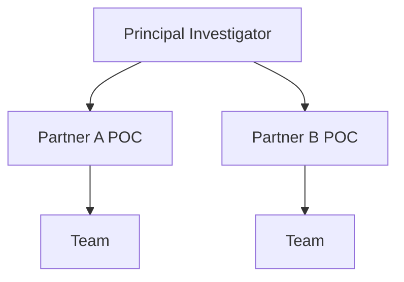
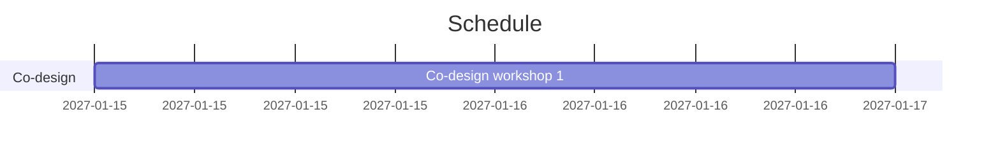

# Tool 10 — Solution Implementation & Impact Monitoring Plan (SIIMP) (Agent Guide)

Read `references/conventions.md` first (shared rules: provenance tags, output format, commands, tool-number → skill-id map). State schema: `references/solution-profile.template.yaml`. Also load `sco-12-meaningful-metrics` for §12.1.

## Purpose
Management and planning template that puts co-development into practice and tracks progress toward results: guides implementation toward outputs/outcomes, sets how impact will be captured, clarifies roles and commitments, tests risks and assumptions, and captures lessons for NASA (incl. Earth Science to Action Strategy, ES2A).

## Inputs
- `project.plan` — Results framework, indicators, adoption plan.
- `report.md` — Stakeholders, ICA, technical requirements, data governance.
- `metrics.json` — Indicator actuals in Phase 3–4.
- Optional: `solution-profile.yaml` from any earlier toolkit skill (reused, never re-asked).

## Outputs
- `project.plan` — Full SIIMP with schedule, roles, budget tables, indicator matrix, plus a YAML patch to `solution-profile.yaml` (schema in `references/solution-profile.template.yaml`).
- Exact table layouts: see **Output Spec** below.

## Steps
1. **Inventory** what the profile already has and print a coverage table: §, source tool, status (filled / partial / missing).
2. For **missing** sections with an owning tool (e.g., §2.1 → `01`, §12.1 → `12`), offer: (a) run that tool now, (b) quick-draft here as `[AI-DRAFT]`, (c) leave placeholder.
3. Draft remaining sections directly with the user, ≤3 questions/turn.
4. Emit the full document in template order.

## Section map (exact template headings)

| § | Heading | Pull from | Ask user |
|---|---|---|---|
| — | Solution Title | meta | |
| 1 | Solution Summary | 01, 05 | background, scope, need, perceived benefit, expected outputs/deliverables |
| 2 | Goals and Objectives | 01 | — (note external factors beyond project control) |
| 2.1 | Results Framework | 01 | finalize |
| 3 | Stakeholders and Partners | 04 | motivation, engagement level, capacity |
| 4 | Key Assumptions, Risks and Mitigation | 01, 06, 11 | data sharing/use assumptions, monitoring-data access/quality assumptions (time-intensive, beyond project life, 3rd/4th-party, controlled socio-economic data); **exclude inputs/outputs** |
| 5 | Solution Co-Development Approach | 01, 07, 08 | bullets: technical milestones · major deliverables · key decision points · launch/deployment · training · outreach & engagement; mark stakeholder-input tasks; align to results framework |
| 6 | Schedule | 5, 11 | dates → Gantt |
| 7 | Technical Requirements | 08 | "Refer to the Technical Requirements template" + summary |
| 8 | Data Governance and Storage | 09 | link/summary |
| 9 | Roles and Responsibilities | 04, 11 | Table 1 + org chart |
| 10 | Sustainability Strategy | 11 | summary |
| 11 | Resource Needs and Budget Considerations | — | Tables 2–5 |
| 12 | Monitoring Solution Implementation and Impact | 12 | how progress is tracked |
| 12.1 | Indicator Monitoring Matrix | 12 | Fillable Indicator Template |
| 12.2 | Detailed outline of planned monitoring activities | — | activities + contribution |
| 13 | Capturing Results | 02 | reporting mechanisms; reuse existing check-ins |
| 14 | Understanding and Capturing Impact | 02, 03 | use cases, case studies, EIA, surveys, KIIs; immediate + medium/long-term |
| 15 | Feedback Loop and Knowledge Sharing | — | methods |
| 15.1 | Internal Feedback Loop and Knowledge Sharing | — | questions |
| 15.2 | Broader NASA SMD Feedback Loop – Contributing to the Virtuous Cycle | — | which NASA elements learn; avenues |

## Output Spec

Full document with the headings above, plus these tables (exact headers):

**Table 1: Roles and Responsibilities**

| Co-Development Partner | Role | Responsibilities |
|---|---|---|

**Org chart** (Mermaid): PI → partner POCs → teams.

**Schedule (Gantt)** — table + Mermaid

| ID | Task / Milestone | Type (Technical / Deliverable / Decision Point / Deployment / Training / Engagement) | Stakeholder Input? | Owner | Start | End | Depends On |
|---|---|---|---|---|---|---|---|

**Table 2: Consolidated Solution Budget**

| Item | Budget Q1 | Budget Q2 | Budget Q 3 | Budget Q 4 |
|---|---|---|---|---|
| FTE | | | | |
| Equipment and Resources | | | | |
| Stakeholder Engagement | | | | |
| Sub-Total | | | | |
| Center Tax (X%)** | | | | |
| Annual Total | | | | |

**Table 3: Budget Estimate Breakdown (WYE/FTE)**

| Item | LOS | Budget Q1 | Budget Q2 | Budget Q3 | Budget Q4 |
|---|---|---|---|---|---|
| [Position Title] (e.g. Physical Scientist) | X WYE/FTE* | | | | |
| [Position Title] (e.g. Postdoc) | X WYE/FTE* | | | | |
| Staff Travel to Meeting/Conference | | | | | |
| Sub-Total | | | | | |
| Center Tax (X%)** | | | | | |
| Annual Total | | | | | |

**Table 4: Budget Estimate Breakdown (Stakeholder Engagement)** — rows: Engagement 1 · Training 1 · … · Engagement N · Training N · Sub-Total · Center Tax (X%)** · Annual Total; columns Item | Budget Q1–Q4.

**Table 5: Budget Estimate Breakdown (Equipment and Resources)** — rows: Software · CloudSpace · Licensing · Publications · Equipment · Maintenance · Operations · Sub-Total · Center Tax (X%)** · Annual Total; columns Item | Budget Q1–Q4.

Budget rules: **never invent dollar figures**. Use user-supplied rates; compute subtotals, center tax, and totals with code if available (show formula: `Sub-Total = Σ items; Center Tax = Sub-Total × X%; Annual Total = Sub-Total + Center Tax`). Tables 3–5 roll up into Table 2.

**12.1 Indicator Monitoring Matrix** — use the Fillable Indicator Template columns from `12-meaningful-metrics.md`.

**12.2 Monitoring activities**

| Activity | Frequency | Contribution to Monitoring | Owner |
|---|---|---|---|
| Bi-weekly Implementation Team Meeting | | Review successes, milestones; discuss obstacles | |
| Stakeholder Meetings | | Feedback on progress/expectations; adoption & sustainability updates | |
| Mid-term review | | Status review mid-project | |
| Pre/post training tests | | Inform designs, guide improvements | |
| Existing reporting requirement(s) | | Efficiency — reuse | |

**15.1 Feedback questions** — tailor these template examples: perceived quality/utility/timeliness of data, tools, apps · unmet data needs · data range/resolution/accessibility feedback · how stakeholders participated in co-design (what worked/less well; vs. plan) · extent of partner deployment and barriers to sustainable deployment.

**Profile patch:** `milestones[]`, `roles[]`, `risks[]`, `indicators[]` (if updated), `meta.phase`.

## Phase modes
- **Phase 2 (create):** full draft.
- **Phase 3 (guide):** user pastes progress → update milestone status, indicator actuals (Year One…), flag slipped items and assumptions under stress.
- **Phase 4 (report):** produce Solution Assessment Report outline (final indicator data, activity reports, stakeholder feedback, EIA data) and hand off to `02`.

## Quality Gate
- [ ] Coverage table shows no "missing" without an accepted open item.
- [ ] §4 contains no inputs/outputs; every assumption has monitoring.
- [ ] Every §5 activity maps to a results-framework tier and a Gantt row.
- [ ] Budget tables arithmetically consistent; no invented numbers.
- [ ] §12.1 has ≥1 indicator per outcome with baseline + target (or plan to obtain).
- [ ] §13–14 cover immediate and medium/long-term capture.
- [ ] §15.2 names specific NASA elements (program, mission, application area).

## Guardrails
- Never invent budget figures; compute totals from user-supplied rates with code.
- Section 4 assumptions must exclude inputs and outputs.
- Never invent people, organizations, quotes, budgets, or baselines; use `<<placeholders>>` and tag AI-drafted rows `[AI-DRAFT]`.
- AI drafts prepare for stakeholder engagement; never present them as stakeholder evidence.
- Never store or echo PII, CUI, or ITAR/EAR-controlled data; replace with placeholders and warn the user.
- Never send, post, or share outputs; produce them for the user to review.

## Example
**Prompt:** Assemble our SIIMP from this solution profile.
**Result:** Prints a coverage table for sections 1–15; Offers to run missing owning skills by id.

## Hand-offs
- Upstream: `sco-01-designing-for-impact`, `sco-04-stakeholder-mapping`, `sco-06-information-chain-analysis`, `sco-08-technical-requirements`, `sco-09-data-governance-storage`, `sco-11-adoption-sustainability`, `sco-12-meaningful-metrics`, `sco-03-economic-impact-assessment`
- Downstream: `sco-02-capturing-communicating-impact`, `sco-00-trust-marker`, `partner-status-brief`

## Source
- Toolkit page: https://science.data.nasa.gov/earth-science-solution-co-development-toolkit/implementation-monitoring/
- Phase: 2 (create) · 3 (guide) · 4 (report)
- Template — Solution_Implementation_and_Impact_Monitoring_Plan.docx: https://science.data.nasa.gov/earth-science-solution-co-development-toolkit/static/toolkit_documents/Solution_Implementation_and_Impact_Monitoring_Plan.docx
- Template — Gantt chart template (Google Sheets): https://docs.google.com/spreadsheets/d/1dVA_GuRyGW3C8-2CpA8DPSYKpElA4ix5LgY0mQtU4f0
- Template — Fillable Indicator Template (Google Sheets): https://docs.google.com/spreadsheets/d/1VGShXy_S_h8P5l0_Lh2ltbeq2Z423EpB/edit?gid=427899109
- Derived from NASA Earth Action Solution Co-Development Toolkit v0.1 (DOI 10.5281/zenodo.19866469).

## References
- `references/conventions.md` — read first, every run.
- `references/solution-profile.template.yaml` — when creating or patching the shared profile.
