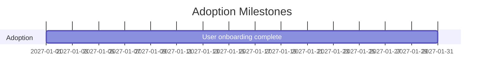

# Tool 11 — Adoption & Sustainability Plan (Agent Guide)

Read `references/conventions.md` first (shared rules: provenance tags, output format, commands, tool-number → skill-id map). State schema: `references/solution-profile.template.yaml`.

## Purpose
Plan how the co-developed solution will be adopted, integrated, maintained, and sustained after development: who uses and owns it, training/support, dependencies, risk reduction, handover or exit.

## Inputs
- `project.plan` — Stakeholders, milestones.
- `report.md` — Needs, UCD, technical and data governance outputs.
- `release.notes` — Delivered versions for handover.
- Optional: `solution-profile.yaml` from any earlier toolkit skill (reused, never re-asked).

## Outputs
- `project.plan` — Adoption and sustainability plan with milestones, roles, risks, handover and exit tables, plus a YAML patch to `solution-profile.yaml` (schema in `references/solution-profile.template.yaml`).
- Exact table layouts: see **Output Spec** below.

## Steps — complete Sections 1–8 in order
Pre-fill aggressively from the profile (partners from `04`, readiness/constraints from `05`, repo/platform from `08`, data stewardship from `09`). Then ask the user to confirm/fill blanks section by section.

1. **Solution Information** — Solution Title · Co-Development Partners and Primary Implementing Partner(s) (from `04`) · Intended Operational Environment and Sustainability Requirements.
2. **Adoption Strategy** — introduction into partner workflows, user needs, capacity assumptions, engagement/training expectations, roles, adoption risks.
   - **2.1 Adoption Goals** — about actual use, workflow integration, ownership (not technical performance). Specific, practical, **time-bound**. Offer tailored versions of: integrated into annual reporting workflow within 12 months of deployment · used by analysts each season from first operational year · validated for operational decision-making by end of pilot · transferred to partner's internal team within 1–2 years · replacing/reducing reliance on manual or legacy methods over a defined transition period.
   - **2.2 End-User Readiness** — institutional mandate alignment · existing workflows supported · technical capacity (software, hardware, staff skills) · data access constraints · training needs · Barriers to Organizational Adoption Readiness (staffing changes, competing priorities, approval processes). Rate each Ready / Partial / Not ready.
   - **2.3 Engagement and Co-Development Traceability** — table below; pull evidence from `05`/`07`.
   - **2.4 Training, Knowledge Transfer & Onboarding** — table below.
3. **Sustainability Strategy** — reference SIIMP.
   - **3.1 Sustainability Objectives** with time horizon (short / medium / ongoing). Offer: runs annually with minimal outside support · data and code kept current beyond project · partner internalizes workflow and ownership · resourced and staffed for sustained operation · knowledge retained across staff turnover · post-project feedback loops for user input, outcomes, impact.
   - **3.2 Technical · 3.3 Data · 3.4 Institutional · 3.5 Resource** — tables below.
4. **Roles Upon Successful Transfer** — table.
5. **Adoption Milestones & Timeline** — table + Mermaid Gantt.
6. **Risk Assessment and Mitigation** — table; Likelihood/Impact as Low/Med/High.
7. **Handover & Long-Term Maintenance** — table.
8. **Exit or Retirement Plan** — table.

## Output Spec (exact tables from template)

**2.3 Engagement and Co-Development Traceability**

| Engagement Element | Description / Evidence | Reference Links (optional) |
|---|---|---|
| User interviews, focus groups, or co-design sessions | | |
| Key user needs identified | | |
| Key user priorities and constraints | | |
| How user feedback was incorporated into adoption planning | | |
| Open feedback items or deferred requests (future versions) | | |
| Stakeholder expectations regarding adoption timeline | | |

**2.4 Training, Knowledge Transfer & Onboarding Plan**

| Training / Onboarding Element | Description | Owner / Responsible Party | Timeline / Frequency |
|---|---|---|---|
| Required training materials (SOPs, slides, videos, job aids) | | | |
| Training sessions (content, duration, format) | | | |
| Delivery format (virtual, in-person, hybrid) | | | |
| Onboarding workflow (e.g., pre-training → hands-on → certification) | | | |
| Ongoing support mechanisms (helpdesk, office hours, maintainer contact) | | | |
| Local champions / focal points | | | |

**3.2 Technical Sustainability**

| Technical Sustainability Element | Description | Owner / Responsible Party | Notes / Dependencies |
|---|---|---|---|
| Repository location and ownership (e.g., GitHub, internal systems) | | | |
| Version control and release strategy | | | |
| Update frequency (annual, seasonal, ad hoc) | | | |
| Required technical skill sets for maintenance | | | |
| Software, library, API, or cloud dependencies requiring monitoring | | | |
| Level of automation in processing pipelines | | | |
| Location of technical documentation and maintenance guides | | | |

**3.3 Data Sustainability**

| Data Sustainability Element | Description | Owner / Responsible Party | Notes / Dependencies |
|---|---|---|---|
| Data inputs required and update schedule | | | |
| Data retention rules and time horizons | | | |
| Storage locations and backup procedures | | | |
| Identified data steward(s) or responsible team(s) | | | |
| Plan for data source changes or discontinuation (e.g., sensor or collection updates) | | | |

**3.4 Institutional Sustainability**

| Institutional Sustainability Element | Description | Owner / Responsible Party | Notes / Dependencies |
|---|---|---|---|
| Long-term owner of the solution (organization and responsible team) | | | |
| Integration into formal workflows, mandates, or reporting cycles | | | |
| Cross-training or redundancy plans to manage staff turnover | | | |
| Requirements for institutionalizing the workflow (e.g., SOPs, approvals, policy alignment) | | | |
| Alignment with ongoing national, regional, or organizational programs | | | |

**3.5 Resource Sustainability**

| Resource Sustainability Element | Description | Estimated Level / Cost | Notes / Assumptions |
|---|---|---|---|
| Estimated annual level of effort to sustain operations | | | |
| Required expertise and roles (e.g., developer, data manager, analyst) | | | |
| Cloud, compute, or storage costs | | | |
| Non-labor costs (e.g., travel, meetings, licensing) | | | |
| Minimum support requirements to keep the solution operational | | | |
| Budget planning considerations (funding sources, cost-sharing) | | | |

**4. Roles and Responsibilities Upon Successful Transfer**

| Role | Responsibility | Assigned Person/Team | Organization |
|---|---|---|---|
| Solution Owner | Oversees long-term operation | | |
| Technical Lead | Code maintenance and updates | | |
| Data Steward | Data updates and QA/QC | | |
| Product Lead | User engagement and roadmap | | |
| Training Lead | Training and onboarding | | |
| Support Contact | First-line troubleshooting | | |
| Documentation Lead | SOPs and manuals | | |
| Communications Lead | Outreach and awareness | | |

**5. Adoption Milestones & Timeline**

| Milestone | Description | Owner | Date |
|---|---|---|---|
| User onboarding complete | All analysts trained | | |
| Pilot season operational | Workflow run end-to-end | | |
| Performance reviewed | Partner sign-off | | |
| Full operational adoption | Solution integrated into annual cycle | | |
| Handover complete | Ownership transferred | | |

**6. Risk Assessment and Mitigation**

| Risk Area | Description | Likelihood | Impact | Mitigation Strategy |
|---|---|---|---|---|
| Technical | Loss of key developer | | | |
| Data | Source data changes | | | |
| Institutional | Staff turnover at partner | | | |
| Resource | No funding for maintenance | | | |
| Adoption | Low user uptake | | | |

(Toolkit example values: Med/High cross-training & documentation · Low/Medium monitoring & adaptable scripts · High/High train multiple focal points · Med/High define minimum support LOE · Low/High co-design & hands-on training. Adapt; don't copy blindly.)

**7. Handover & Long-Term Maintenance Plan**

| Handover & Maintenance Element | Description | Owner / Responsible Party | Timing / Frequency |
|---|---|---|---|
| Handover conditions (e.g., training completed, pilot executed, documentation finalized) | | | |
| Required documentation (user guides, SOPs, technical and data documentation) | | | |
| Knowledge transfer activities (training sessions, shadowing, walkthroughs, recorded demos) | | | |
| Post-handover contacts (technical, data, operational support) | | | |
| Expected update cycle after handover (code, documentation) | | | |
| Conditions for re-engagement (major upgrades, data changes, system modifications) | | | |

**8. Exit or Retirement Plan**

| Exit / Retirement Element | Description | Owner / Responsible Party | Timing / Triggers |
|---|---|---|---|
| Criteria for retiring or replacing the solution (e.g., no longer meets user needs, replaced by newer system, loss of data availability, lack of resources) | | | |
| Steps to archive code and data (final versioning, storage location, documentation, access permissions) | | | |
| Communication plan for users (advance notice, timelines, alternatives, points of contact) | | | |
| Migration path to alternative solutions, if required (data transfer, workflow transition, user guidance) | | | |

**Profile patch:** `adoption.*`, `risks[]` (area R-xx), `milestones[]`, `roles[]`.

## Quality Gate
- [ ] Every adoption goal is time-bound and about use/ownership.
- [ ] A named long-term owner organization (or explicit open item).
- [ ] Single-point-of-failure roles have cross-training plan.
- [ ] Data source discontinuation plan exists.
- [ ] Minimum support LOE estimated.
- [ ] Handover conditions are verifiable.
- [ ] Exit criteria defined.

## Guardrails
- Adoption goals must be about use and ownership and time-bound, not technical performance.
- Never assign named people to roles; use roles or user-supplied names.
- Never invent people, organizations, quotes, budgets, or baselines; use `<<placeholders>>` and tag AI-drafted rows `[AI-DRAFT]`.
- AI drafts prepare for stakeholder engagement; never present them as stakeholder evidence.
- Never store or echo PII, CUI, or ITAR/EAR-controlled data; replace with placeholders and warn the user.
- Never send, post, or share outputs; produce them for the user to review.

## Example
**Prompt:** Draft our adoption and sustainability plan for handing the flood tool to the district DRM.
**Result:** Includes sections 1–8 with exact template table rows; Adoption goals are time-bound.

## Hand-offs
- Upstream: `sco-04-stakeholder-mapping`, `sco-05-needs-assessment`, `sco-07-user-centered-design`, `sco-08-technical-requirements`, `sco-09-data-governance-storage`
- Downstream: `sco-10-implementation-monitoring-plan`, `sco-00-trust-marker`

## Source
- Toolkit page: https://science.data.nasa.gov/earth-science-solution-co-development-toolkit/adoption-sustainability/
- Phase: 2 (update in 3–4)
- Template — Solution_Adoption_and_Sustainability_Plan_Template.docx: https://science.data.nasa.gov/earth-science-solution-co-development-toolkit/static/toolkit_documents/Solution_Adoption_and_Sustainability_Plan_Template.docx
- Derived from NASA Earth Action Solution Co-Development Toolkit v0.1 (DOI 10.5281/zenodo.19866469).

## References
- `references/conventions.md` — read first, every run.
- `references/solution-profile.template.yaml` — when creating or patching the shared profile.
