# Skill Catalog

_Generated by `scripts/build_registry.py` — do not edit by hand._

## GIT (1)

| Skill | Status | Version | Inputs → Outputs | Owner | Summary |
|---|---|---|---|---|---|
| [`reproducible-release`](../GIT/reproducible-release) |  | 0.1.0 | `code.repo`, `metrics.json`, `model.checkpoint` → `release.notes`, `env.lock` | @MayerT1 | Cut a SemVer, citable, environment-pinned release of a research repo with attached results. |

## Science (3)

| Skill | Status | Version | Inputs → Outputs | Owner | Summary |
|---|---|---|---|---|---|
| [`classification-accuracy-assessment`](../Science/classification-accuracy-assessment) |  | 0.1.0 | `samples.csv`, `dataset.raster` → `metrics.json`, `report.md` | @MayerT1 | Area-adjusted accuracy + area estimates with 95% CIs for any classified map. |
| [`foundation-model-finetune`](../Science/foundation-model-finetune) |  | 0.1.0 | `dataset.raster`, `partner.request` → `metrics.json`, `model.checkpoint`, `report.md` | @MayerT1 | Fair, multi-seed fine-tuning and intercomparison of GeoFMs (Prithvi, TerraMind…) vs a non-FM baseline on a locked, checked data recipe. |
| [`pinecone-rx-fire-valuation`](../Science/pinecone-rx-fire-valuation) |  | 0.1.0 | `aoi.geojson`, `dataset.vector`, `dataset.raster` → `metrics.json`, `report.md`, `figure.png` | @MayerT1 | PINECONe GEE biomass/carbon/water stages + Monte Carlo Total Economic Value for prescribed-fire vs wildfire scenarios. |

## Solution Management (15)

| Skill | Status | Version | Inputs → Outputs | Owner | Summary |
|---|---|---|---|---|---|
| [`partner-status-brief`](../Solution_Management/partner-status-brief) |  | 0.1.0 | `metrics.json`, `release.notes`, `report.md`, `project.plan`, `partner.request` → `stakeholder.brief` | @MayerT1 | One-page, decision-focused partner/leadership brief built only from Science and GIT outputs. |
| [`sco-00-trust-marker`](../Solution_Management/sco-00-trust-marker) |  | 0.1.0 | `project.plan`, `report.md` → `report.md` | @MayerT1 | Scores co-development depth on five TRUST dimensions (0–4) with evidence, targets, and gap-closing actions. |
| [`sco-01-designing-for-impact`](../Solution_Management/sco-01-designing-for-impact) |  | 0.1.0 | `partner.request` → `project.plan` | @MayerT1 | Builds the if/then pathway, results framework (inputs→outputs→outcomes→impact), and assumption record. |
| [`sco-02-capturing-communicating-impact`](../Solution_Management/sco-02-capturing-communicating-impact) |  | 0.1.0 | `project.plan`, `metrics.json`, `report.md` → `stakeholder.brief`, `report.md` | @MayerT1 | Plans audiences and evidence for impact communication and drafts NASA-format products (highlight, use case, case study, blog, press release). |
| [`sco-03-economic-impact-assessment`](../Solution_Management/sco-03-economic-impact-assessment) |  | 0.1.0 | `partner.request`, `project.plan` → `metrics.json`, `report.md` | @MayerT1 | Scopes an EIA (high-level vs in-depth), plans baseline/attribution data, and computes transparent value estimates with sensitivity ranges. |
| [`sco-04-stakeholder-mapping`](../Solution_Management/sco-04-stakeholder-mapping) |  | 0.1.0 | `partner.request` → `report.md` | @MayerT1 | Identifies, categorizes, and scores stakeholders (influence/interest 1–4) and assigns Collaborate/Align/Validate/Monitor strategies. |
| [`sco-05-needs-assessment`](../Solution_Management/sco-05-needs-assessment) |  | 0.1.0 | `report.md`, `partner.request` → `partner.request`, `report.md` | @MayerT1 | Captures, codes, themes, and prioritizes user needs per user group and translates them into draft EO requirements. |
| [`sco-06-information-chain-analysis`](../Solution_Management/sco-06-information-chain-analysis) |  | 0.1.0 | `partner.request`, `report.md` → `report.md` | @MayerT1 | Traces one decision pathway as numbered chain links, stress-tests handoffs, prioritizes breakdowns, and assigns actions and assumptions. |
| [`sco-07-user-centered-design`](../Solution_Management/sco-07-user-centered-design) |  | 0.1.0 | `partner.request`, `report.md` → `report.md` | @MayerT1 | Builds decision-anchored personas and runs the four-step UCD method through validation under decision conditions. |
| [`sco-08-technical-requirements`](../Solution_Management/sco-08-technical-requirements) |  | 0.1.0 | `partner.request`, `report.md` → `report.md` | @MayerT1 | Completes the Technical Requirements Template: partner questions, data source specs, architecture, I/O, platforms, validation, capacities. |
| [`sco-09-data-governance-storage`](../Solution_Management/sco-09-data-governance-storage) |  | 0.1.0 | `report.md` → `report.md` | @MayerT1 | Drafts a FAIR, SPD-41a-compliant Data Governance and Storage Plan with data inventory and 15-row checklist. |
| [`sco-10-implementation-monitoring-plan`](../Solution_Management/sco-10-implementation-monitoring-plan) |  | 0.1.0 | `project.plan`, `report.md`, `metrics.json` → `project.plan` | @MayerT1 | Assembles the 15-section SIIMP from other toolkit outputs with Gantt, budget tables 1–5, and indicator matrix. |
| [`sco-11-adoption-sustainability`](../Solution_Management/sco-11-adoption-sustainability) |  | 0.1.0 | `project.plan`, `report.md`, `release.notes` → `project.plan` | @MayerT1 | Drafts the Solution Adoption and Sustainability Plan sections 1–8 with all template tables. |
| [`sco-12-meaningful-metrics`](../Solution_Management/sco-12-meaningful-metrics) |  | 0.1.0 | `project.plan`, `metrics.json` → `project.plan` | @MayerT1 | Develops SMART input/output/outcome/impact indicators and fills the 15-column Fillable Indicator Template. |
| [`sco-toolkit-orchestrator`](../Solution_Management/sco-toolkit-orchestrator) |  | 0.1.0 | `partner.request` → `project.plan`, `issue.list` | @MayerT1 | Routes Earth Action solution teams to the right Co-Development Toolkit skill and tracks progress in a shared solution profile. |

## Connection map (auto-derived from I/O contracts)

```mermaid
flowchart LR
  subgraph GIT
    reproducible-release[reproducible-release]
  end
  subgraph Science
    classification-accuracy-assessment[classification-accuracy-assessment]
    foundation-model-finetune[foundation-model-finetune]
    pinecone-rx-fire-valuation[pinecone-rx-fire-valuation]
  end
  subgraph Solution_Management
    partner-status-brief[partner-status-brief]
    sco-00-trust-marker[sco-00-trust-marker]
    sco-01-designing-for-impact[sco-01-designing-for-impact]
    sco-02-capturing-communicating-impact[sco-02-capturing-communicating-impact]
    sco-03-economic-impact-assessment[sco-03-economic-impact-assessment]
    sco-04-stakeholder-mapping[sco-04-stakeholder-mapping]
    sco-05-needs-assessment[sco-05-needs-assessment]
    sco-06-information-chain-analysis[sco-06-information-chain-analysis]
    sco-07-user-centered-design[sco-07-user-centered-design]
    sco-08-technical-requirements[sco-08-technical-requirements]
    sco-09-data-governance-storage[sco-09-data-governance-storage]
    sco-10-implementation-monitoring-plan[sco-10-implementation-monitoring-plan]
    sco-11-adoption-sustainability[sco-11-adoption-sustainability]
    sco-12-meaningful-metrics[sco-12-meaningful-metrics]
    sco-toolkit-orchestrator[sco-toolkit-orchestrator]
  end
  classification-accuracy-assessment -- metrics.json --> partner-status-brief
  classification-accuracy-assessment -- metrics.json --> reproducible-release
  classification-accuracy-assessment -- metrics.json --> sco-02-capturing-communicating-impact
  classification-accuracy-assessment -- metrics.json --> sco-10-implementation-monitoring-plan
  classification-accuracy-assessment -- metrics.json --> sco-12-meaningful-metrics
  classification-accuracy-assessment -- report.md --> partner-status-brief
  classification-accuracy-assessment -- report.md --> sco-00-trust-marker
  classification-accuracy-assessment -- report.md --> sco-02-capturing-communicating-impact
  classification-accuracy-assessment -- report.md --> sco-05-needs-assessment
  classification-accuracy-assessment -- report.md --> sco-06-information-chain-analysis
  classification-accuracy-assessment -- report.md --> sco-07-user-centered-design
  classification-accuracy-assessment -- report.md --> sco-08-technical-requirements
  classification-accuracy-assessment -- report.md --> sco-09-data-governance-storage
  classification-accuracy-assessment -- report.md --> sco-10-implementation-monitoring-plan
  classification-accuracy-assessment -- report.md --> sco-11-adoption-sustainability
  foundation-model-finetune -- metrics.json --> partner-status-brief
  foundation-model-finetune -- metrics.json --> reproducible-release
  foundation-model-finetune -- metrics.json --> sco-02-capturing-communicating-impact
  foundation-model-finetune -- metrics.json --> sco-10-implementation-monitoring-plan
  foundation-model-finetune -- metrics.json --> sco-12-meaningful-metrics
  foundation-model-finetune -- model.checkpoint --> reproducible-release
  foundation-model-finetune -- report.md --> partner-status-brief
  foundation-model-finetune -- report.md --> sco-00-trust-marker
  foundation-model-finetune -- report.md --> sco-02-capturing-communicating-impact
  foundation-model-finetune -- report.md --> sco-05-needs-assessment
  foundation-model-finetune -- report.md --> sco-06-information-chain-analysis
  foundation-model-finetune -- report.md --> sco-07-user-centered-design
  foundation-model-finetune -- report.md --> sco-08-technical-requirements
  foundation-model-finetune -- report.md --> sco-09-data-governance-storage
  foundation-model-finetune -- report.md --> sco-10-implementation-monitoring-plan
  foundation-model-finetune -- report.md --> sco-11-adoption-sustainability
  pinecone-rx-fire-valuation -- metrics.json --> partner-status-brief
  pinecone-rx-fire-valuation -- metrics.json --> reproducible-release
  pinecone-rx-fire-valuation -- metrics.json --> sco-02-capturing-communicating-impact
  pinecone-rx-fire-valuation -- metrics.json --> sco-10-implementation-monitoring-plan
  pinecone-rx-fire-valuation -- metrics.json --> sco-12-meaningful-metrics
  pinecone-rx-fire-valuation -- report.md --> partner-status-brief
  pinecone-rx-fire-valuation -- report.md --> sco-00-trust-marker
  pinecone-rx-fire-valuation -- report.md --> sco-02-capturing-communicating-impact
  pinecone-rx-fire-valuation -- report.md --> sco-05-needs-assessment
  pinecone-rx-fire-valuation -- report.md --> sco-06-information-chain-analysis
  pinecone-rx-fire-valuation -- report.md --> sco-07-user-centered-design
  pinecone-rx-fire-valuation -- report.md --> sco-08-technical-requirements
  pinecone-rx-fire-valuation -- report.md --> sco-09-data-governance-storage
  pinecone-rx-fire-valuation -- report.md --> sco-10-implementation-monitoring-plan
  pinecone-rx-fire-valuation -- report.md --> sco-11-adoption-sustainability
  reproducible-release -- release.notes --> partner-status-brief
  reproducible-release -- release.notes --> sco-11-adoption-sustainability
  sco-00-trust-marker -- report.md --> partner-status-brief
  sco-00-trust-marker -- report.md --> sco-02-capturing-communicating-impact
  sco-00-trust-marker -- report.md --> sco-05-needs-assessment
  sco-00-trust-marker -- report.md --> sco-06-information-chain-analysis
  sco-00-trust-marker -- report.md --> sco-07-user-centered-design
  sco-00-trust-marker -- report.md --> sco-08-technical-requirements
  sco-00-trust-marker -- report.md --> sco-09-data-governance-storage
  sco-00-trust-marker -- report.md --> sco-10-implementation-monitoring-plan
  sco-00-trust-marker -- report.md --> sco-11-adoption-sustainability
  sco-01-designing-for-impact -- project.plan --> partner-status-brief
  sco-01-designing-for-impact -- project.plan --> sco-00-trust-marker
  sco-01-designing-for-impact -- project.plan --> sco-02-capturing-communicating-impact
  sco-01-designing-for-impact -- project.plan --> sco-03-economic-impact-assessment
  sco-01-designing-for-impact -- project.plan --> sco-10-implementation-monitoring-plan
  sco-01-designing-for-impact -- project.plan --> sco-11-adoption-sustainability
  sco-01-designing-for-impact -- project.plan --> sco-12-meaningful-metrics
  sco-02-capturing-communicating-impact -- report.md --> partner-status-brief
  sco-02-capturing-communicating-impact -- report.md --> sco-00-trust-marker
  sco-02-capturing-communicating-impact -- report.md --> sco-05-needs-assessment
  sco-02-capturing-communicating-impact -- report.md --> sco-06-information-chain-analysis
  sco-02-capturing-communicating-impact -- report.md --> sco-07-user-centered-design
  sco-02-capturing-communicating-impact -- report.md --> sco-08-technical-requirements
  sco-02-capturing-communicating-impact -- report.md --> sco-09-data-governance-storage
  sco-02-capturing-communicating-impact -- report.md --> sco-10-implementation-monitoring-plan
  sco-02-capturing-communicating-impact -- report.md --> sco-11-adoption-sustainability
  sco-03-economic-impact-assessment -- metrics.json --> partner-status-brief
  sco-03-economic-impact-assessment -- metrics.json --> reproducible-release
  sco-03-economic-impact-assessment -- metrics.json --> sco-02-capturing-communicating-impact
  sco-03-economic-impact-assessment -- metrics.json --> sco-10-implementation-monitoring-plan
  sco-03-economic-impact-assessment -- metrics.json --> sco-12-meaningful-metrics
  sco-03-economic-impact-assessment -- report.md --> partner-status-brief
  sco-03-economic-impact-assessment -- report.md --> sco-00-trust-marker
  sco-03-economic-impact-assessment -- report.md --> sco-02-capturing-communicating-impact
  sco-03-economic-impact-assessment -- report.md --> sco-05-needs-assessment
  sco-03-economic-impact-assessment -- report.md --> sco-06-information-chain-analysis
  sco-03-economic-impact-assessment -- report.md --> sco-07-user-centered-design
  sco-03-economic-impact-assessment -- report.md --> sco-08-technical-requirements
  sco-03-economic-impact-assessment -- report.md --> sco-09-data-governance-storage
  sco-03-economic-impact-assessment -- report.md --> sco-10-implementation-monitoring-plan
  sco-03-economic-impact-assessment -- report.md --> sco-11-adoption-sustainability
  sco-04-stakeholder-mapping -- report.md --> partner-status-brief
  sco-04-stakeholder-mapping -- report.md --> sco-00-trust-marker
  sco-04-stakeholder-mapping -- report.md --> sco-02-capturing-communicating-impact
  sco-04-stakeholder-mapping -- report.md --> sco-05-needs-assessment
  sco-04-stakeholder-mapping -- report.md --> sco-06-information-chain-analysis
  sco-04-stakeholder-mapping -- report.md --> sco-07-user-centered-design
  sco-04-stakeholder-mapping -- report.md --> sco-08-technical-requirements
  sco-04-stakeholder-mapping -- report.md --> sco-09-data-governance-storage
  sco-04-stakeholder-mapping -- report.md --> sco-10-implementation-monitoring-plan
  sco-04-stakeholder-mapping -- report.md --> sco-11-adoption-sustainability
  sco-05-needs-assessment -- partner.request --> foundation-model-finetune
  sco-05-needs-assessment -- partner.request --> partner-status-brief
  sco-05-needs-assessment -- partner.request --> sco-01-designing-for-impact
  sco-05-needs-assessment -- partner.request --> sco-03-economic-impact-assessment
  sco-05-needs-assessment -- partner.request --> sco-04-stakeholder-mapping
  sco-05-needs-assessment -- partner.request --> sco-06-information-chain-analysis
  sco-05-needs-assessment -- partner.request --> sco-07-user-centered-design
  sco-05-needs-assessment -- partner.request --> sco-08-technical-requirements
  sco-05-needs-assessment -- partner.request --> sco-toolkit-orchestrator
  sco-05-needs-assessment -- report.md --> partner-status-brief
  sco-05-needs-assessment -- report.md --> sco-00-trust-marker
  sco-05-needs-assessment -- report.md --> sco-02-capturing-communicating-impact
  sco-05-needs-assessment -- report.md --> sco-06-information-chain-analysis
  sco-05-needs-assessment -- report.md --> sco-07-user-centered-design
  sco-05-needs-assessment -- report.md --> sco-08-technical-requirements
  sco-05-needs-assessment -- report.md --> sco-09-data-governance-storage
  sco-05-needs-assessment -- report.md --> sco-10-implementation-monitoring-plan
  sco-05-needs-assessment -- report.md --> sco-11-adoption-sustainability
  sco-06-information-chain-analysis -- report.md --> partner-status-brief
  sco-06-information-chain-analysis -- report.md --> sco-00-trust-marker
  sco-06-information-chain-analysis -- report.md --> sco-02-capturing-communicating-impact
  sco-06-information-chain-analysis -- report.md --> sco-05-needs-assessment
  sco-06-information-chain-analysis -- report.md --> sco-07-user-centered-design
  sco-06-information-chain-analysis -- report.md --> sco-08-technical-requirements
  sco-06-information-chain-analysis -- report.md --> sco-09-data-governance-storage
  sco-06-information-chain-analysis -- report.md --> sco-10-implementation-monitoring-plan
  sco-06-information-chain-analysis -- report.md --> sco-11-adoption-sustainability
  sco-07-user-centered-design -- report.md --> partner-status-brief
  sco-07-user-centered-design -- report.md --> sco-00-trust-marker
  sco-07-user-centered-design -- report.md --> sco-02-capturing-communicating-impact
  sco-07-user-centered-design -- report.md --> sco-05-needs-assessment
  sco-07-user-centered-design -- report.md --> sco-06-information-chain-analysis
  sco-07-user-centered-design -- report.md --> sco-08-technical-requirements
  sco-07-user-centered-design -- report.md --> sco-09-data-governance-storage
  sco-07-user-centered-design -- report.md --> sco-10-implementation-monitoring-plan
  sco-07-user-centered-design -- report.md --> sco-11-adoption-sustainability
  sco-08-technical-requirements -- report.md --> partner-status-brief
  sco-08-technical-requirements -- report.md --> sco-00-trust-marker
  sco-08-technical-requirements -- report.md --> sco-02-capturing-communicating-impact
  sco-08-technical-requirements -- report.md --> sco-05-needs-assessment
  sco-08-technical-requirements -- report.md --> sco-06-information-chain-analysis
  sco-08-technical-requirements -- report.md --> sco-07-user-centered-design
  sco-08-technical-requirements -- report.md --> sco-09-data-governance-storage
  sco-08-technical-requirements -- report.md --> sco-10-implementation-monitoring-plan
  sco-08-technical-requirements -- report.md --> sco-11-adoption-sustainability
  sco-09-data-governance-storage -- report.md --> partner-status-brief
  sco-09-data-governance-storage -- report.md --> sco-00-trust-marker
  sco-09-data-governance-storage -- report.md --> sco-02-capturing-communicating-impact
  sco-09-data-governance-storage -- report.md --> sco-05-needs-assessment
  sco-09-data-governance-storage -- report.md --> sco-06-information-chain-analysis
  sco-09-data-governance-storage -- report.md --> sco-07-user-centered-design
  sco-09-data-governance-storage -- report.md --> sco-08-technical-requirements
  sco-09-data-governance-storage -- report.md --> sco-10-implementation-monitoring-plan
  sco-09-data-governance-storage -- report.md --> sco-11-adoption-sustainability
  sco-10-implementation-monitoring-plan -- project.plan --> partner-status-brief
  sco-10-implementation-monitoring-plan -- project.plan --> sco-00-trust-marker
  sco-10-implementation-monitoring-plan -- project.plan --> sco-02-capturing-communicating-impact
  sco-10-implementation-monitoring-plan -- project.plan --> sco-03-economic-impact-assessment
  sco-10-implementation-monitoring-plan -- project.plan --> sco-11-adoption-sustainability
  sco-10-implementation-monitoring-plan -- project.plan --> sco-12-meaningful-metrics
  sco-11-adoption-sustainability -- project.plan --> partner-status-brief
  sco-11-adoption-sustainability -- project.plan --> sco-00-trust-marker
  sco-11-adoption-sustainability -- project.plan --> sco-02-capturing-communicating-impact
  sco-11-adoption-sustainability -- project.plan --> sco-03-economic-impact-assessment
  sco-11-adoption-sustainability -- project.plan --> sco-10-implementation-monitoring-plan
  sco-11-adoption-sustainability -- project.plan --> sco-12-meaningful-metrics
  sco-12-meaningful-metrics -- project.plan --> partner-status-brief
  sco-12-meaningful-metrics -- project.plan --> sco-00-trust-marker
  sco-12-meaningful-metrics -- project.plan --> sco-02-capturing-communicating-impact
  sco-12-meaningful-metrics -- project.plan --> sco-03-economic-impact-assessment
  sco-12-meaningful-metrics -- project.plan --> sco-10-implementation-monitoring-plan
  sco-12-meaningful-metrics -- project.plan --> sco-11-adoption-sustainability
  sco-toolkit-orchestrator -- project.plan --> partner-status-brief
  sco-toolkit-orchestrator -- project.plan --> sco-00-trust-marker
  sco-toolkit-orchestrator -- project.plan --> sco-02-capturing-communicating-impact
  sco-toolkit-orchestrator -- project.plan --> sco-03-economic-impact-assessment
  sco-toolkit-orchestrator -- project.plan --> sco-10-implementation-monitoring-plan
  sco-toolkit-orchestrator -- project.plan --> sco-11-adoption-sustainability
  sco-toolkit-orchestrator -- project.plan --> sco-12-meaningful-metrics
```

177 connections, 50 cross-team.
