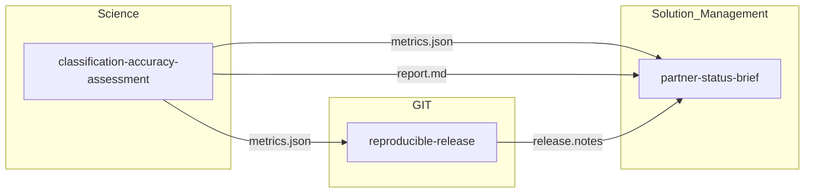

# Skill Catalog

_Generated by `scripts/build_registry.py` — do not edit by hand._

## GIT (1)

| Skill | Status | Version | Inputs → Outputs | Owner | Summary |
|---|---|---|---|---|---|
| [`reproducible-release`](../GIT/reproducible-release) |  | 0.1.0 | `code.repo`, `metrics.json`, `model.checkpoint` → `release.notes`, `env.lock` | @MayerT1 | Cut a SemVer, citable, environment-pinned release of a research repo with attached results. |

## Science (1)

| Skill | Status | Version | Inputs → Outputs | Owner | Summary |
|---|---|---|---|---|---|
| [`classification-accuracy-assessment`](../Science/classification-accuracy-assessment) |  | 0.1.0 | `samples.csv`, `dataset.raster` → `metrics.json`, `report.md` | @MayerT1 | Area-adjusted accuracy + area estimates with 95% CIs for any classified map. |

## Solution Management (1)

| Skill | Status | Version | Inputs → Outputs | Owner | Summary |
|---|---|---|---|---|---|
| [`partner-status-brief`](../Solution_Management/partner-status-brief) |  | 0.1.0 | `metrics.json`, `release.notes`, `report.md`, `project.plan`, `partner.request` → `stakeholder.brief` | @MayerT1 | One-page, decision-focused partner/leadership brief built only from Science and GIT outputs. |

## Connection map (auto-derived from I/O contracts)

4 connections, 4 cross-team.
