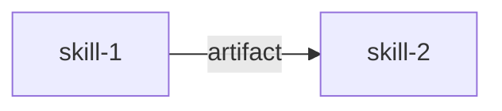

# Workflow: {trigger}-to-{outcome}

**Problem:** {one sentence}
**Trigger:** {what starts it}
**Outcome:** {what the partner/program gets}
**Status:** draft

## Steps
| # | Skill | Team | Consumes | Produces | Hand-off owner |
|---|---|---|---|---|---|
| 1 | `skill-id` | Science | `type` | `type` | role / @handle |

## How to run it
1. …

## Run log
| Date | Project | Result / link | Notes |
|---|---|---|---|
