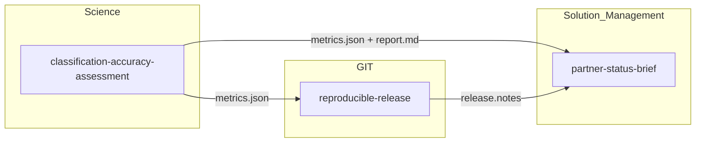

# Workflow: model-to-partner-delivery

**Problem:** A finished map/model reaches a partner with inconsistent accuracy reporting, no reproducible release, and technical language the partner can't act on.
**Trigger:** Science says "the map is done."
**Outcome:** The partner receives a validated, versioned, citable product and a one-page brief tied to their decision.
**Status:** draft

## Steps
| # | Skill | Team | Consumes | Produces | Hand-off owner |
|---|---|---|---|---|---|
| 1 | `classification-accuracy-assessment` | Science | `samples.csv`, `dataset.raster` | `metrics.json`, `report.md` | Project scientist |
| 2 | `reproducible-release` | GIT | `code.repo`, `metrics.json` | `release.notes`, `env.lock` | Repo maintainer |
| 3 | `partner-status-brief` | Solution Management | `metrics.json`, `release.notes`, `partner.request` | `stakeholder.brief` | Partner lead |

## How to run it
1. **Scientist** (Science Claude account): "Run an accuracy assessment on `samples.csv` with these mapped areas." Commit `results/metrics.json` + `report.md` to the project repo (or a shared Drive folder) and open a hand-off issue tagged `handoff:git`.
2. **Maintainer** (GIT account): "Cut a release and attach `results/metrics.json`." Confirms the command block, tags, publishes. Comments the release URL on the hand-off issue, retags `handoff:solution-management`.
3. **Partner lead** (Solution Management account): "Write a partner brief from `metrics.json`, the v{X} release notes and the original partner request." Reviews, sends, closes the issue with a link to the brief.

Every hand-off is a **file in an agreed artifact format + an issue**, so each team can work in its own Claude account without sharing conversations.

## Run log
| Date | Project | Result / link | Notes |
|---|---|---|---|
| _none yet_ | | | |
