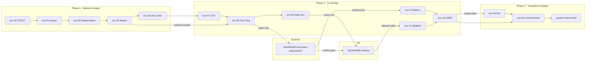

# Workflow: partner-need-to-co-developed-solution

**Problem:** EO solutions get built around a science gap instead of a partner decision, and the toolkit's static templates (stakeholder map, needs assessment, information chain, SIIMP, metrics) are filled out in isolation, so the plan, product, and impact evidence don't line up.
**Trigger:** A partner need or new solution idea arrives (often a `partner.request`).
**Outcome:** A co-developed solution with a linked results framework, prioritized needs, delivery chain, technical and data plans, a SIIMP with indicators, an adoption/handover plan, and impact communication, all carried in one `solution-profile.yaml`.
**Status:** draft

Source: [NASA Earth Science Solution Co-Development Toolkit](https://science.data.nasa.gov/earth-science-solution-co-development-toolkit/) v0.1. Start any run with `sco-toolkit-orchestrator`; it routes to the steps below and tracks `/status`.

## Steps
| # | Skill | Team | Consumes | Produces | Hand-off owner |
|---|---|---|---|---|---|
| 0 | `sco-00-trust-marker` (baseline) | Solution Management | `project.plan` | `report.md` | Solution lead |
| 1 | `sco-01-designing-for-impact` | Solution Management | `partner.request` | `project.plan` | Solution lead |
| 2 | `sco-04-stakeholder-mapping` | Solution Management | `partner.request` | `report.md` | Engagement lead |
| 3 | `sco-05-needs-assessment` | Solution Management | `report.md` | `partner.request` (needs + EO requirements), `report.md` | Needs assessment lead |
| 4 | `sco-06-information-chain-analysis` | Solution Management | `partner.request`, `report.md` | `report.md` | Engagement lead |
| 5 | `sco-07-user-centered-design` | Solution Management | `partner.request`, `report.md` | `report.md` | Product lead |
| 6 | `sco-08-technical-requirements` | Solution Management → Science / GIT | `partner.request`, `report.md` | `report.md` | EO technical lead |
| 7 | `sco-09-data-governance-storage` | Solution Management → GIT | `report.md` | `report.md` | Data manager |
| 8 | `sco-12-meaningful-metrics` | Solution Management | `project.plan`, `metrics.json` | `project.plan` | MEL lead |
| 9 | `sco-11-adoption-sustainability` | Solution Management | `project.plan`, `report.md`, `release.notes` | `project.plan` | Solution lead |
| 10 | `sco-10-implementation-monitoring-plan` | Solution Management | `project.plan`, `report.md`, `metrics.json` | `project.plan` | Solution lead |
| — | *Science builds/validates* e.g. `classification-accuracy-assessment` | Science | `samples.csv`, `dataset.raster` | `metrics.json`, `report.md` | Project scientist |
| — | *GIT releases* `reproducible-release` | GIT | `code.repo`, `metrics.json` | `release.notes` | Repo maintainer |
| 11 | `sco-03-economic-impact-assessment` | Solution Management | `partner.request`, `project.plan` | `metrics.json`, `report.md` | Economist / impact analyst |
| 12 | `sco-02-capturing-communicating-impact` | Solution Management | `project.plan`, `metrics.json`, `report.md` | `stakeholder.brief`, `report.md` | Comms lead |
| 13 | `partner-status-brief` | Solution Management | `project.plan`, `metrics.json`, `release.notes` | `stakeholder.brief` | Partner lead |
| 14 | `sco-00-trust-marker` (re-score) | Solution Management | `project.plan`, `report.md` | `report.md` | Solution lead |

## How to run it
1. **Solution lead** (Solution Management account): install `sco-toolkit-orchestrator` + all `sco-*` skills. Say "Where do we start? <solution + partner need>". Commit `solution-profile.yaml` to the project repo after each skill (each run emits a YAML patch).
2. After `sco-05` and `sco-08`, open a **hand-off issue** tagged `handoff:science` with the needs/EO requirements (`partner.request`) and technical requirements (`report.md`).
3. **Scientist** (Science account) builds and validates; commits `metrics.json` + `report.md`; retags `handoff:git`.
4. **Maintainer** (GIT account) runs `reproducible-release` using the data governance plan from `sco-09`; comments `release.notes`; retags `handoff:solution-management`.
5. **Solution lead** feeds `metrics.json` actuals into `sco-12` / `sco-10` (Phase 3), then runs `sco-03`, `sco-02`, `partner-status-brief`, and re-scores `sco-00` at transition.

Every AI-drafted row is tagged `[AI-DRAFT]` and must be validated with stakeholders (`/validate` generates the script) before it goes to partners or NASA reporting.

## Run log
| Date | Project | Result / link | Notes |
|---|---|---|---|
